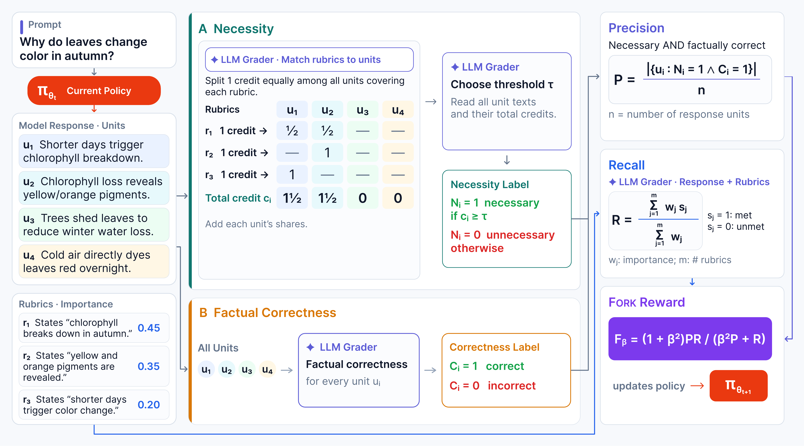

# Eat Your Precision: Precision Objective Mitigates Reward Hacking in Rubric-Based RL

[](https://arxiv.org/abs/2610.33512)  [](#bibtex)  [](LICENSE)

Official implementation of **FORK**, a reward for rubric-based reinforcement learning that jointly optimizes rubric recall and a unit-level precision objective, as presented in our paper:  
[**Eat Your Precision: Precision Objective Mitigates Reward Hacking in Rubric-Based RL**](https://arxiv.org/abs/2610.33512)  
by Hyun Ryu<sup>\*1,2</sup>, Jong-Heon Kim<sup>\*1</sup>, Yiqing Xie<sup>2</sup>, Seungone Kim<sup>2</sup>, Carolyn Rosé<sup>†2</sup> and Eunho Yang<sup>†1</sup>  
<sup>1</sup>Korea Advanced Institute of Science & Technology &nbsp;&nbsp; <sup>2</sup>Carnegie Mellon University Language Technologies Institute &nbsp;&nbsp; <sup>\*</sup>Equal Contribution &nbsp;&nbsp; <sup>†</sup>Equal Advising

<p align="center">
  
</p>

---

## 🔔 Updates
- [✔] (26.10.24) Paper is out! [here](https://arxiv.org/abs/2610.33512)

---

## 📖 Overview

Rubric-based rewards score a response by its weighted rubric coverage, a recall objective, so a policy trained against them learns to be complete but also verbose and inaccurate. FORK adds a precision objective (paper Section 3):

- The response is split into sentence-level units.
- A grader matches each rubric to the units that address it and shares the rubric's credit among them. It then sets the credit threshold a unit must reach to count as necessary (Figures 5 to 7).
- A second call labels every unit factually correct or not (Figures 8 to 9).
- Precision is the fraction of units that are both necessary and correct. Recall is the standard rubric coverage. The reward is their F<sub>β</sub> (Eq. 6).

This repository contains:

- the reward as a [verl](https://github.com/volcengine/verl) custom reward function (`src/fork/rewards/`, `src/fork/grader/`), in the three formulations of the paper's main comparison: **Standard** (recall only), **Generic Criteria** (precision from one labeling call) and **FORK** (credit-based necessity and factual correctness, β = 1 or 1.25).
- the training grader, Qwen3.6-35B-A3B served by vLLM (`configs/grader/`, `scripts/serve_grader.sh`).
- the prepared RubricHub-Medical and RubricHub-Science splits and the HealthBench and ResearchQA pools, with the builders that rebuild them from pinned sources (`data/`, `src/fork/data/`).
- the evaluation behind the paper's tables and figures, with GPT-5.4 or the training grader as the judge (`src/fork/eval/`, `scripts/eval.sh`, `scripts/trajectory.sh`).

The other baselines and ablations of the paper are not part of this release.

## 🔧 Setup

The paper's runs use 8 NVIDIA H100: the policy trainer on four GPUs and four replicas of the training grader on the other four. Two environments are needed, because the grader model requires a newer vLLM than verl 0.7.0 allows:

```bash
conda create -n fork python=3.10 && conda activate fork
pip install -r requirements/trainer.txt          # training, data preparation and evaluation (verl 0.7.0, vLLM 0.12, PyTorch 2.9)
conda create -n fork-grader python=3.12 && conda activate fork-grader
pip install -r requirements/grader.txt           # serving the training grader only (vLLM 0.26)
cp .env.example .env                             # OPENAI_API_KEY for the evaluation judge; WANDB_API_KEY and HF_TOKEN are optional
```

## 🏋️ Data

[`data/`](./data) ships everything the paper trains and evaluates on:

- RubricHub-Medical: 12,519 train / 1,391 test prompts
- RubricHub-Science: 12,519 train / 1,467 test prompts, with the ResearchQA-sourced prompts excluded
- HealthBench pool: 100 conversations
- ResearchQA pool: 100 queries

Formats and provenance are in [`data/README.md`](./data/README.md). Before training, convert the splits to verl's format:

```bash
bash scripts/prepare_data.sh        # add --rebuild to rebuild everything from the pinned sources, byte for byte
```

## 🚀 Training

```bash
bash scripts/serve_grader.sh                                      # grader environment, GPUs 4-7. Leave it running.
bash scripts/train.sh configs/train/fork_beta1.25_medical.yaml    # trainer environment, GPUs 0-3
```

- One config per run of the paper's main tables lives in [`configs/train/`](./configs/train): `standard_medical`, `standard_science`, `generic_criteria_medical`, `fork_beta1_medical`, `fork_beta1.25_medical`, `fork_beta1.25_science`.
- A run config holds only the reward's switches: `reward`, `beta`, `precision`, `domain`. The GRPO hyperparameters shared by every run are in [`configs/grpo.yaml`](./configs/grpo.yaml).
- A run writes to `outputs/train/<run_id>/`: the checkpoints, every grader call of every rollout, and the per-step reward statistics.
- Rerunning the same command resumes from the last checkpoint.
- `--print` shows the verl command line without launching anything. The GPU and batch knobs are documented at the top of [`scripts/train.sh`](./scripts/train.sh).

## 📊 Evaluation

```bash
bash scripts/eval.sh base_medical                      # the base policy first. It is the comparator.
bash scripts/eval.sh fork_beta1.25_medical             # a run at its last checkpoint. --step N picks another.
python -m fork.eval.report --label base_medical --label fork_beta1.25_medical@291 --vs base_medical
```

`eval.sh` runs the evaluation of the paper's Tables 1 and 2 for one model:

- merges the checkpoint
- generates greedy responses on the 100-prompt test subset and on the out-of-domain pool
- grades rubric recall and precision
- judges the responses pairwise against the base policy, under two judge prompts
- grades the out-of-domain pool the benchmark's own way
- prints the row in the paper's columns

Every step is guarded by its output file, so rerunning the command resumes an interrupted evaluation. The judge is GPT-5.4 by default (`--judge gpt54`). `--judge local` uses the training grader on its replicas instead, the setting of Figure 3.

Beyond Tables 1 and 2:

- Table 3: `python -m fork.eval.rubric_types --config configs/eval/medical.yaml`, then the report with `--rubric-types outputs/rubric_types/medical.jsonl`
- Table 4: the report with `--prompt p2`
- Table 8: the report with `--dimensions`
- Figure 1: `bash scripts/trajectory.sh <run_id>`, which scores every checkpoint of a run with the training grader

The settings of each domain are in [`configs/eval/`](./configs/eval).

## 📝 Prompts

Every grader and judge prompt is a text file under [`prompts/`](./prompts). The body of each file is, byte for byte, the prompt the paper's runs used. The header names its role and provenance.

- `train/`: the three FORK calls (Figures 5 to 9), Generic Criteria (Figure 14), and the rubric recall prompt of Mahmoud et al. (2026)
- `eval/`: the precision grader, the rubric-free judge prompt of Mahmoud et al. (2026), the MT-Bench judge prompt (Table 4), the two benchmarks' own graders, and the rubric typing prompt (Table 3)

The science-domain and refusal-rescue variants sit beside their originals.

## 🗂️ Repository layout

```
configs/        grpo.yaml (shared hyperparameters), train/ (the runs), grader/ (the training grader), data/ (the builders), eval/ (per domain)
data/           the prepared splits and the OOD pools (data/README.md)
prompts/        train/ (the reward graders), eval/ (the judges)
scripts/        prepare_data.sh, serve_grader.sh, train.sh, eval.sh, trajectory.sh
src/fork/       grader/ (client, templates, parsers), rewards/ (recall, unitization, the FORK chain, Generic Criteria, F-beta, verl_reward.py),
                data/ (the builders), eval/ (the lanes and the report), launch.py (the run config and verl's command line)
requirements/   the two pinned environments
```

<a id="bibtex"></a>
## 📚 BibTeX
If you find this repository useful for your research, please consider citing us:

```
@article{ryu2026eat,
  title={Eat Your Precision: Precision Objective Mitigates Reward Hacking in Rubric-Based RL},
  author={Ryu, Hyun and Kim, Jong-Heon and Xie, Yiqing and Kim, Seungone and Rose, Carolyn and Yang, Eunho},
  journal={arXiv preprint arXiv:2610.33512},
  year={2026}
}
```

## 📄 License and acknowledgements

Released under the [Apache License 2.0](LICENSE).

- Training runs on [verl](https://github.com/volcengine/verl).
- The data comes from [RubricHub](https://huggingface.co/datasets/sojuL/RubricHub_v1), whose science prompts are attributed to [RaR-Science](https://huggingface.co/datasets/ScaleAI/RaR-Science), [MegaScience](https://huggingface.co/datasets/MegaScience/MegaScience) and [ResearchQA](https://huggingface.co/datasets/realliyifei/ResearchQA).
- The out-of-domain evaluation uses [HealthBench](https://github.com/openai/simple-evals) and [ResearchQA](https://github.com/realliyifei/ResearchQA) with their own grader prompts.
- The recall and rubric-free judge prompts follow Mahmoud et al. (2026). The second judge prompt is MT-Bench's (Zheng et al., 2023).
- The training grader is [Qwen3.6-35B-A3B](https://huggingface.co/Qwen/Qwen3.6-35B-A3B-FP8) and the base policy is [Qwen2.5-7B-Instruct](https://huggingface.co/Qwen/Qwen2.5-7B-Instruct).

## ✉️ Contact
If you have any questions or feedback, feel free to reach out:
- Hyun Ryu: hyunr@andrew.cmu.edu
- Jong-Heon Kim: jongheon@kaist.ac.kr
